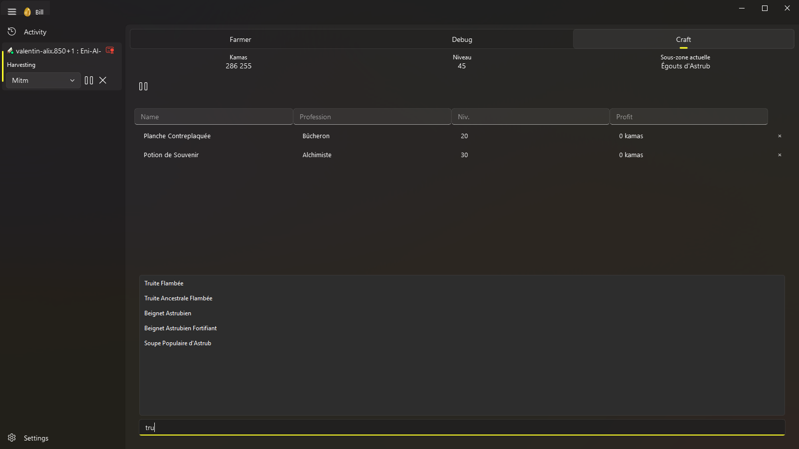
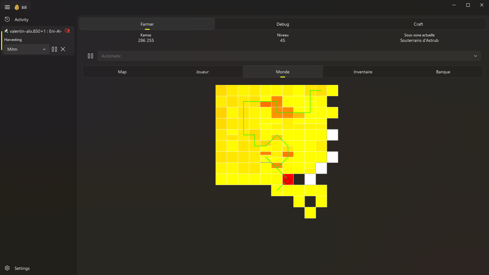

# Bill

Automate your Dofus Unity activities from one Windows interface. Manage multiple
accounts, run harvesting, combat, or crafting activities, and schedule your sessions.

**[Download for Windows](https://github.com/Valentin-alix/ThisIsBillBot/releases/latest)**
· [Getting started](#getting-started) · [Configuration guide](docs/configuration.md)

See Bill in action: harvesting in Dofus Unity with the bot's live monitoring
alongside the game.


## What you can do

### Harvest and keep track of your character

Choose an activity and an area, then start or pause it from the account controls.
The **Farmer** view brings your character's level, kamas, current area, and map
together, with tabs for the character, world, inventory, and bank.


### Run with or without the game client

Use **Socket** mode to communicate directly with the game servers without opening
the Dofus Unity client.


### Prepare your crafting list

Search supported professions for recipes and add them to your crafting list.
Keep the recipes you want to make together in the **Craft** view.



### Choose what Bill automates

Configure behaviors from **Settings**, including automatic combat, marketplace
sales, and crafting. Define several time slots per day, assign accounts to
schedules, and manage email accounts and proxies from the same page.


### Stay informed about your sessions

Review recent events, warnings, and errors on the **Activity** page, with a filter
by account. Inspect quarantined items and decide whether to restore or delete them.


### Follow the route between maps

See where your character is heading in the **World** view. The route appears
directly on the map overview, making it easy to follow movements between areas.



## What the project includes

The bot is written in Python and uses PyQt6 and FluentWidgets for its interface.
It supports two connection modes:

- **Socket**: communicates directly with the game servers without using the Dofus Unity client.
- **MITM**: sits between the Dofus Unity client and the servers to intercept and process their traffic.

In both modes, received messages update the game state, which harvesting, combat,
and crafting behaviors react to.

The repository also contains supporting tools:

- **An Ankama launcher emulator** for interactions with Ankama services.
- **A protocol mapper** that matches obfuscated messages and fields to their unobfuscated counterparts, primarily through static analysis with the IDA Pro API. See the [protobuf mapping guide](docs/mapping.md).
- **A Unity static-data reader** for game data such as items, recipes, spells, monsters, and maps.

## Getting started

### Download

To use the bot, download the Windows archive from the [latest release](https://github.com/Valentin-alix/ThisIsBillBot/releases/latest),
extract it, and run `ThisIsBillBot.exe`.

### From source

Requirements: **Windows**, **Python 3.12**, **Git LFS**, and **uv**.
Clone this repository, then open PowerShell in its root directory:

```powershell
git lfs install
git lfs pull
uv sync
uv run playwright install chromium
Copy-Item .env.example .env
uv run python __main__.py
```

Copy `.env.example` only during the first installation; keep your existing `.env`
if you already have one.

MITM mode requires Dofus Unity installed through the Ankama launcher. Cytrus is
optional and is only used for automatic updates. The mapping tools are not
required to open the interface.

### Initial configuration

1. Under **Settings → Behaviors**, choose the activities to automate.
2. Under **Settings → Schedules**, define operating days and times.
3. Under **Settings → Accounts**, assign accounts to the available profiles.
4. Use the account controls to start an activity; check **Activity** if an error occurs.

Behavior changes take effect the next time the bot starts. Account automation
settings take effect at the next operation without interrupting the current one.

See the [interface configuration guide](docs/configuration.md) for accounts,
schedules, email accounts, proxies, and services.

## Development

The bot code is in `src/`, the launcher is in `AnkamaLauncherEmulator/`, and the
data and mapping libraries are in `DBDofusUnity/`. Standalone tools live in
`scripts/`, grouped under `packaging/`, `launcher/`, `maintenance/`, `mapping/`,
and `data/`, with the Vulture whitelist at `scripts/vulture_whitelist.py`.
Run Python tools from the
repository root, for example `uv run python -m scripts.maintenance.main --help`.

### Inspect messages and logs

The **Debug** view lets you inspect client and server messages, compare obfuscated
and unobfuscated fields, and search the bot's logs. It brings protocol inspection
and behavior diagnostics into the interface when you need to investigate a session.

To start the standalone sniffer from the repository root, run
`uv run python -m scripts.mapping.sniffer`.


### Build UABEA DLLs

Build the UABEA DLLs before using the Unity static-data tools. Install **.NET 10**
and **Visual Studio C++ build tools (v145)**, then run this command from the
repository root in **Git Bash on Windows**:

```bash
bash scripts/packaging/build-tools.sh
```

The script builds UABEA, Il2CppInspector, and protodec.

### Protocol mapping and checks

Each new Dofus build obfuscates protobuf message and field names again. The
mapping must therefore be regenerated and verified before the protocol can be
considered up to date.

```powershell
uv run ruff check .
uv run pyright
uv run pytest tests
```

The final `uv run poe verify` check also applies Ruff fixes. See the
[architecture and development guide](docs/maintenance.md) to understand the code
organization and extend the bot.
